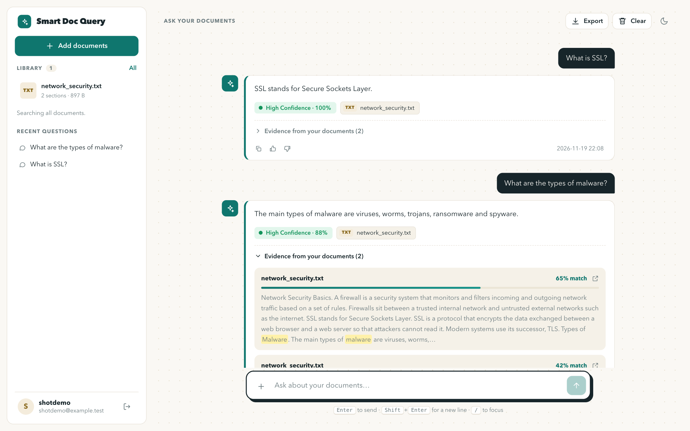
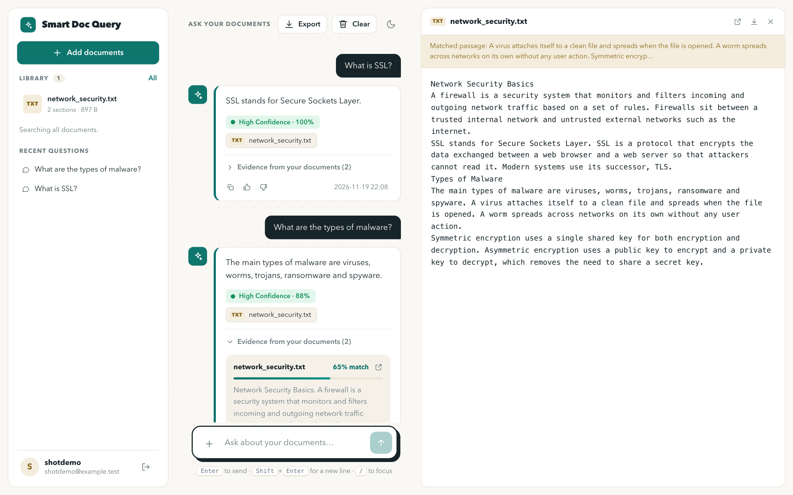
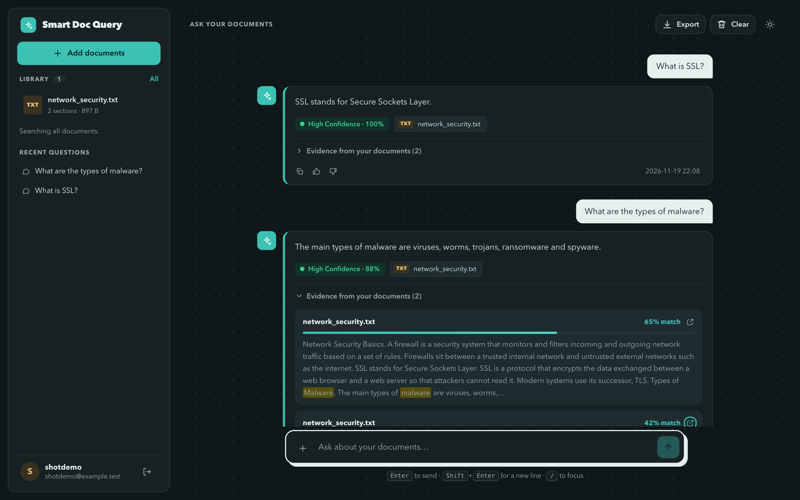
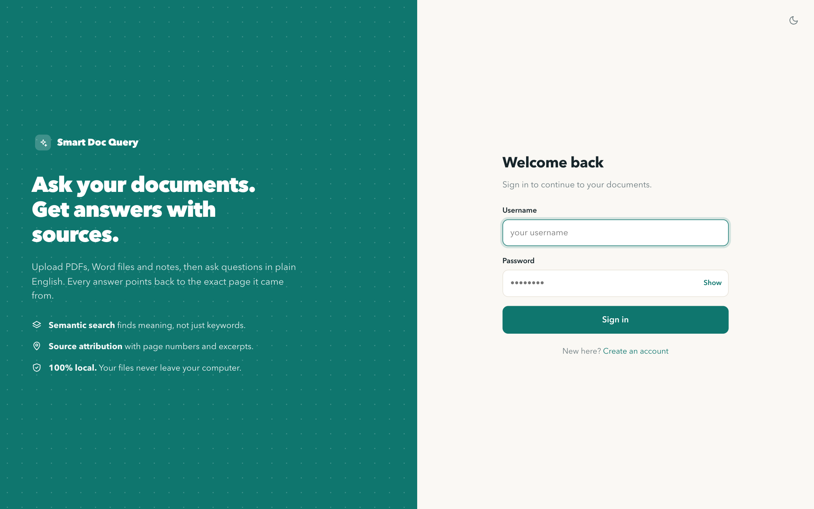

<h1 align="center">Smart Document Query System</h1>

<p align="center">
  <strong>Ask your own documents questions in plain English and get answers with sources.</strong>
</p>

<p align="center">
  
  
  
  
  
</p>

Upload PDF, Word, text or Markdown files, ask a question, and the system finds the
passages that answer it, then shows the answer with the document, page and the exact
evidence it came from. Everything runs locally: no API keys, no accounts, no data
leaving your computer.

> MCA Final Year Project | University of Calicut | 2025-26

---

## Screenshots

| | |
|---|---|
|  |  |
| Answers show confidence, source file and the matching passages. | Click a source to read the original beside the chat. |
|  |  |
| Dark theme. | Sign in. |

## Features

**Documents**
- Upload several files at once (PDF, DOCX, TXT, Markdown), by clicking or dragging them anywhere onto the page
- Per-document page count, section count and size; open the original file from the library
- Choose which documents a question searches, or search them all

**Answers**
- Semantic search (MiniLM embeddings, cosine similarity) combined with a small keyword bonus
- Extractive answers from DistilBERT, restricted to the retrieved passages
- Definition and list questions get special handling (bullet lists for "types of...", "steps in...")
- **Confidence rating** on every answer, and a clear "not in your documents" reply instead of a guess
- **Evidence panel**: the top passages with page number, match percentage and the question's key words highlighted
- Copy an answer, give it a thumbs up or down, export the whole chat as Markdown

**Accounts and security**
- Passwords hashed with scrypt (older plain-text accounts are upgraded automatically on next login)
- CSRF protection on every form and API call, login lockout after repeated failures
- Every search, file download and delete is scoped to the signed-in user
- Uploaded files are stored under random names; the secret key is generated per install

**Interface**
- Redesigned chat interface with light and dark themes, a responsive layout for phones, and no page reloads while asking
- Works offline with system fonts only

## Quick start

Requires Python 3.10-3.12 (PyTorch 2.2 has no wheels for newer versions) and about 8 GB of RAM.

```bash
git clone https://github.com/hibamkm/Smart-Document-Query-System.git
cd Smart-Document-Query-System
python -m venv venv
source venv/bin/activate        # Windows: venv\Scripts\activate
pip install -r requirements.txt
python app.py
```

Open http://localhost:5001, create an account, add a document and ask a question.

The first run downloads the AI models (about 330 MB). After that the app works offline.

Optional environment variables: `PORT`, `SECRET_KEY`, `DATA_DIR` (where the database and uploads live), `FLASK_DEBUG=1`.

## How it works

```
Upload   extract text (PDF page by page) -> clean -> split into ~150-word chunks -> embed (384-dim) -> SQLite
Ask      embed the question -> score every chunk of the user's documents (one matrix product)
         -> boost definition / list / keyword matches -> keep the top passages
Answer   definition rule, list extraction or DistilBERT span extraction -> polish
         -> confidence + sources + evidence saved with the question
```

## Project structure

```
app.py                 Flask routes, auth, CSRF, JSON API
config.py              Settings (paths, limits, secret key)
database.py            SQLite schema and automatic migrations
document_processor.py  PDF / DOCX / TXT / MD extraction and chunking
retrieval.py           Embeddings, ranking, answer generation
templates/             base, auth (login/register), chat page
static/                style.css (design system), app.js (shell), chat.js (chat)
```

## Known limitations

- Scanned PDFs need OCR, which is not implemented
- Images and diagrams are ignored; tables in PDFs may extract badly (DOCX tables are supported)
- Answers are extracted from your text, not generated, so very open questions ("summarize this") work poorly
- Sessions, login lockout counters and the model run in a single process; use a proper WSGI server and database to deploy publicly

## Roadmap

- [ ] OCR for scanned PDFs
- [ ] Summaries and multi-turn follow-up questions
- [ ] Stronger multilingual embedding model
- [ ] Cloud deployment

## Documentation

[PROJECT_DOCUMENTATION.md](PROJECT_DOCUMENTATION.md) has the detailed technical write-up (schema, algorithms, testing). It was written for the first version, so check it against this README before submitting.

## License

Released under the [MIT License](LICENSE).

## Author

**Hiba**, MCA, University of Calicut, 2025-26

## References

1. Lewis et al. (2020), "Retrieval-Augmented Generation for Knowledge-Intensive NLP Tasks"
2. Devlin et al. (2018), "BERT: Pre-training of Deep Bidirectional Transformers"
3. Reimers & Gurevych (2019), "Sentence-BERT: Sentence Embeddings using Siamese BERT-Networks"
